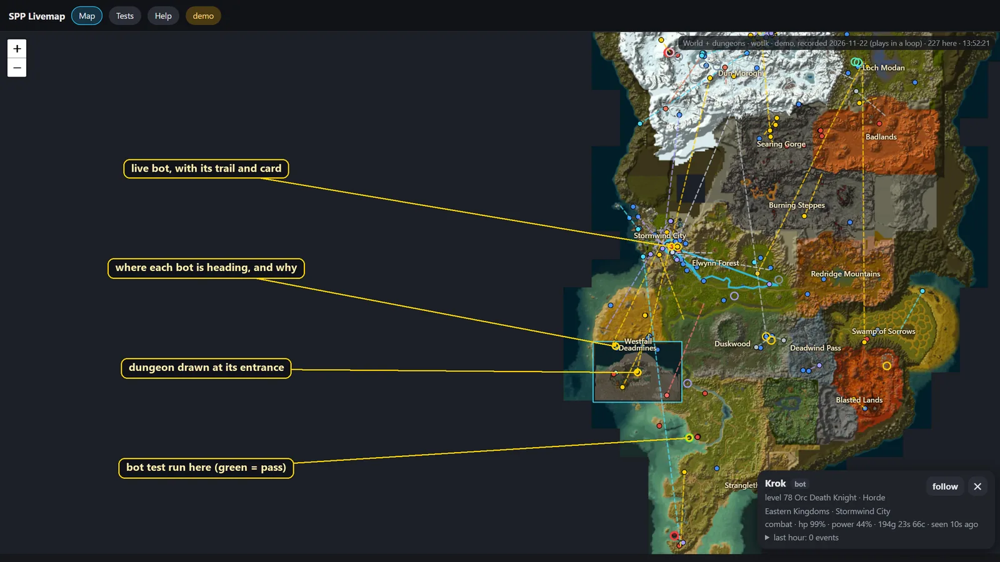
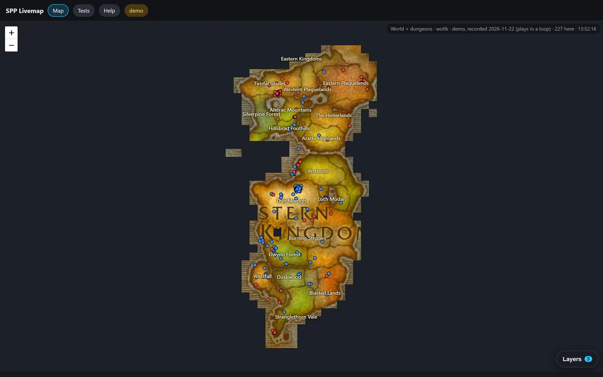
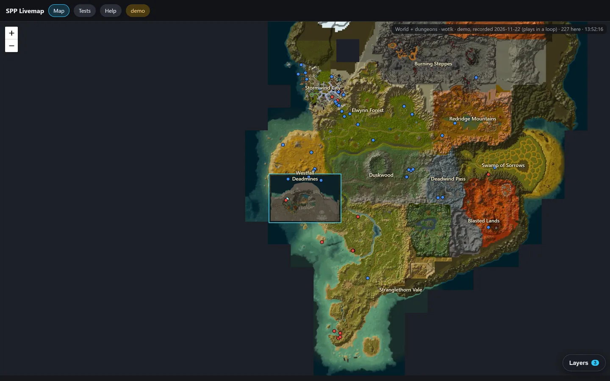
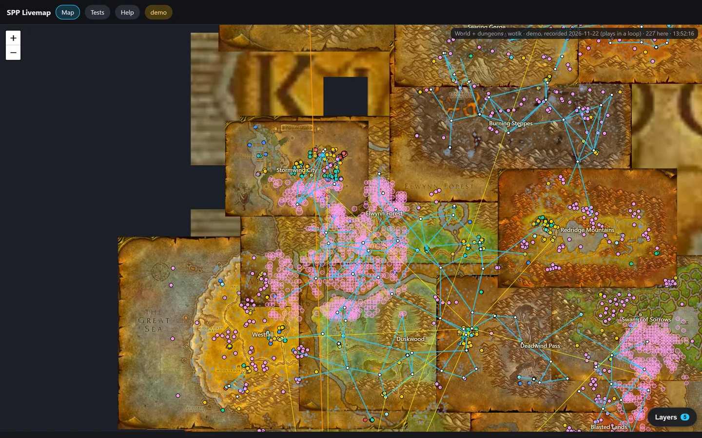
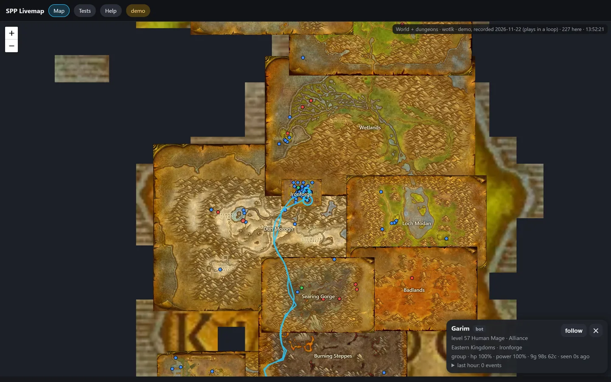
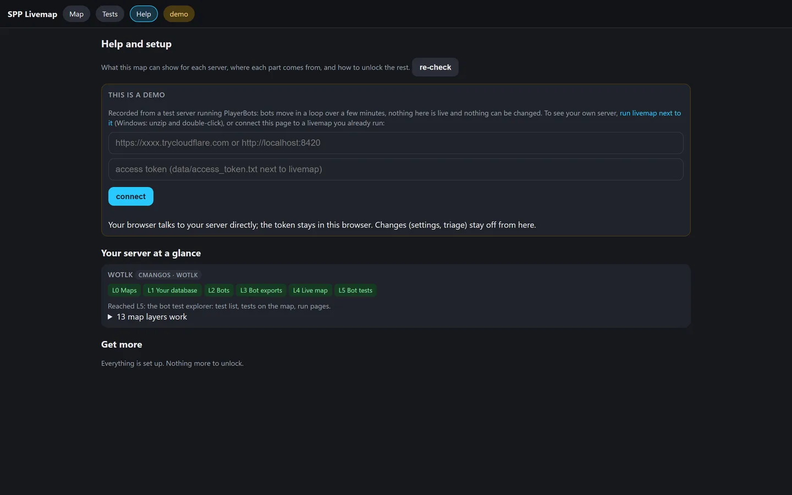
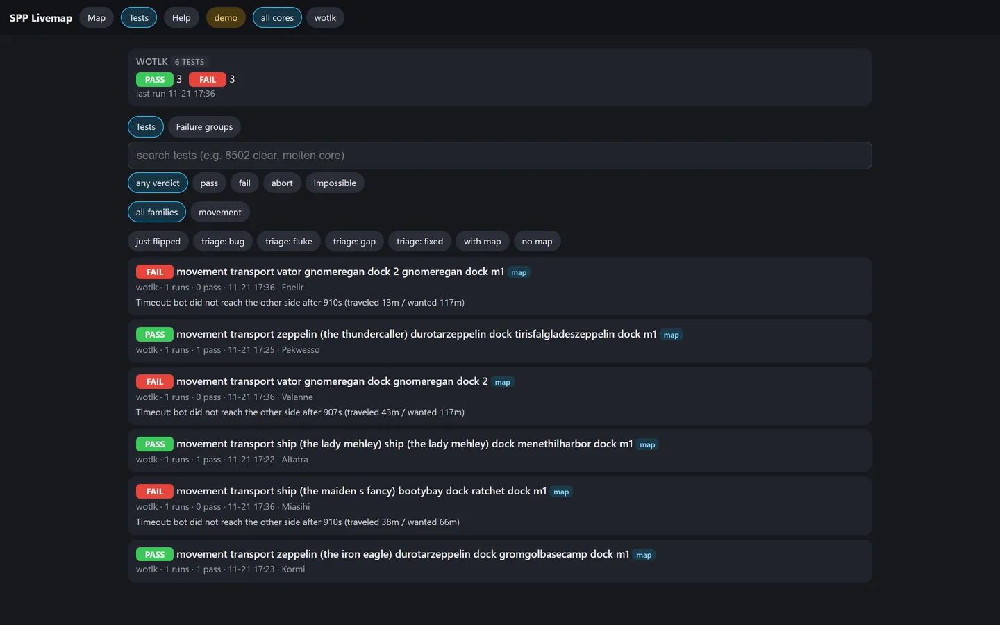
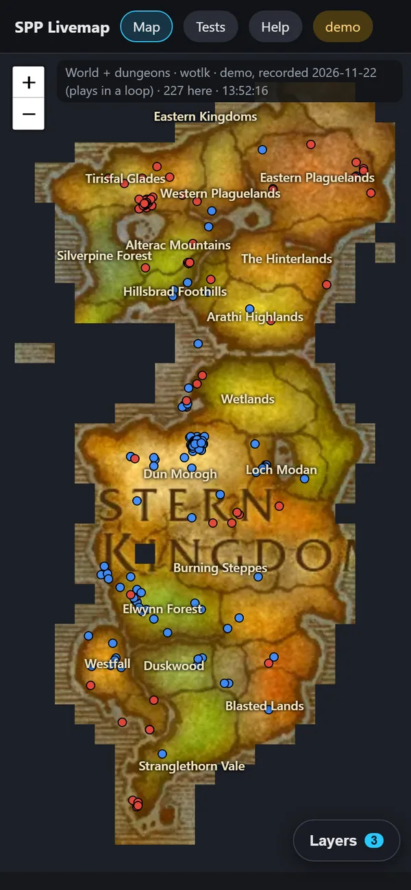
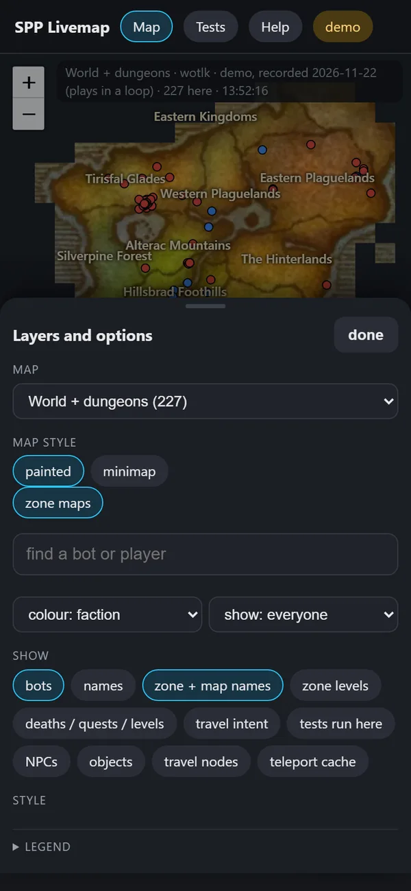
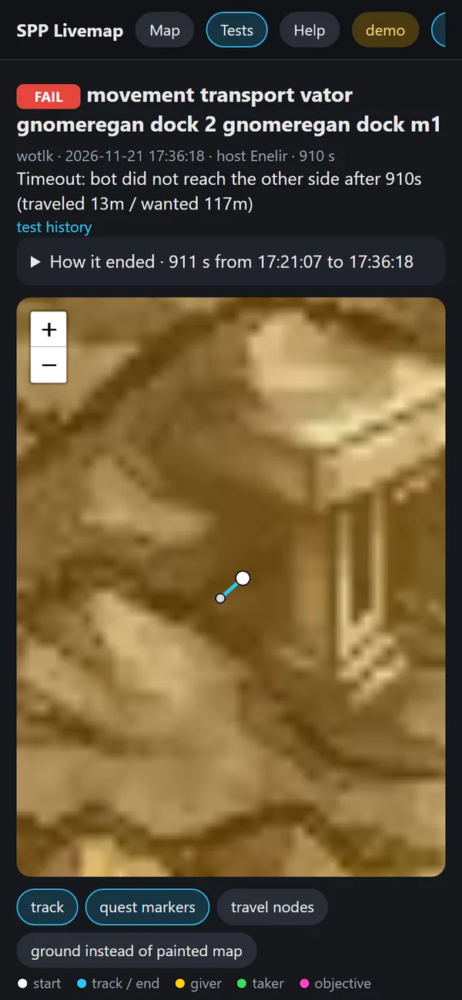

# SPP Livemap

**A live map for your CMaNGOS / vmangos server that you open in a browser, also on your phone.** It
shows who is online and where, puts every dungeon at its real entrance, draws NPCs, quest givers and
the bots' travel network, and for PlayerBots servers shows what thousands of bots are doing right now:
where they walk, why, where they died and which tests they passed.



**[Try the demo in your browser](https://mostlikely4r.github.io/spp-map/)** (recorded from a test
server, nothing to install) · **[Download for Windows](https://github.com/mostlikely4r/spp-map/releases/latest)**
(unzip, double-click) · works with vanilla, TBC and WotLK.

What sets it apart from item/quest database maps: it reads **your** server (who is online, where your
bots go), it draws **dungeons at their entrances** on one world map instead of on separate pages,
everything comes **from your own game client** (no downloads of map art), and it runs as one small
program next to your server.

## What you get

The map works with whatever you have and tells you how to unlock the next step. The **Help** page
(and `python -m livemap doctor`) shows which step each server reached, and gives the exact config
line for anything that is missing.

| Step | You have | You get |
| --- | --- | --- |
| L0 | the game client | world, continent and dungeon maps, zone names, dungeons at their entrances |
| L1 | + your server's database | online players, NPCs, objects and quest givers on the map |
| L2 | + PlayerBots | bots on the map (positions as of their last save) |
| L3 | + the bot log exports (one click on the Help page) | travel intent, teleport cache, zone levels, recent deaths / quests / level-ups |
| L4 | + a PlayerBots build with the live-map exports | the real live map: positions every 5 s, trails, follow a bot, bot state |
| L5 | + bot test results (bot developers) | test explorer, tests on the map, run pages |

| | |
| --- | --- |
|  |  |
| Live bots on the painted world map | Minimap art, dungeons placed at their entrances |
|  |  |
| NPCs by role and the bots' travel network | Tap a bot: level, class, zone, money, trail, events |
|  |  |
| Help: what works and how to get the rest | Test list with flips and regressions (bot developers) |

On a phone:

| | | |
| --- | --- | --- |
|  |  |  |

## Quick start

**Windows, no install:** download the zip from
[Releases](https://github.com/mostlikely4r/spp-map/releases/latest), unzip it anywhere (next to your
server, a USB stick ...) and double-click **`livemap.cmd`**. The browser opens on a setup page:
pick your game client (found automatically) and, if you run a server, its `mangosd.conf`. Click
**save** and the map opens. Everything the tool writes stays inside its own folder.

Just want to look? Double-click **`livemap_demo.cmd`** (no server, database or game client needed).

**Linux / macOS / your own Python (3.11+):**

```
pip install -r requirements.txt
python -m livemap serve --open      # http://127.0.0.1:8420
python -m livemap demo --open       # the recorded demo
```

## Setup by server type

The setup page writes `livemap.toml` for you. To write it by hand, start from
[`livemap.example.toml`](livemap.example.toml); one `[[core]]` block per server:

- **SPP repack** (Classics V2): put `spp_root = "C:/Games/SPP_Classics_V2/SPP_Server"` at the top and
  add `name = "vanilla"` / `"tbc"` / `"wotlk"` cores with only the `client` path. Logs, DBC files,
  databases and the PlayerBots config are found automatically.
- **Plain CMaNGOS:** `mangosd_conf = "<path>/mangosd.conf"` and `client = "<path>/Data"`. The world,
  characters and login databases, `LogsDir` and `DataDir` are read from mangosd.conf.
- **vmangos:** the same two lines; the vmangos config keys (`WorldDatabase.Info` ...) and its
  versioned database tables are recognised. Bots and players come from the characters database (the
  live-map exports are not in vmangos yet).
- **With PlayerBots:** `aiplayerbot.conf` next to mangosd.conf is picked up. The Help page has an
  **Enable** button per group of log exports (it adds them to `AiPlayerbot.AllowedLogFiles`, keeps a
  `.bak` copy, never removes anything); restart the world server and the layers appear by themselves.
- **Bot developers:** builds with `GenerateBotTests` write `bot_test_results*.log`; the Tests tab and
  the "tests run here" layer appear as soon as results exist.

## Remote access (phone)

`livemap_tunnel.cmd` (or `serve --tunnel`) opens a free Cloudflare quick tunnel and prints a link
with an access token (needs `cloudflared`, `winget install Cloudflare.cloudflared`). Open it once on
your phone; it remembers the token and drops it from the address. Without the token every request
gets 401. The token lives in `data/access_token.txt` (delete it to issue a new one). From a remote
session nothing on your PC can be changed unless you set `allow_remote_write = true`.

**The online demo page can connect to your server too:** on its Help page, paste your tunnel link (or
`http://localhost:8420` on the same PC). Your browser then talks to your livemap directly; the data
never passes through GitHub. Only the origin in `pages_origin` (the official demo page by default) is
allowed, the token is always required, and changes are always off from there. Note that the token then
travels in the map-image addresses too (an image cannot send a header), so it can show up in the
tunnel's logs; delete `data/access_token.txt` to issue a new one whenever you like.

Running your own copy of the Pages site (a fork): Settings → Pages → "Deploy from a branch",
`gh-pages`, `/ (root)`, once; the workflow publishes that branch on every push.

## FAQ

- **The map is empty / grey.** Set the game client `Data` folder (Help page). The first start builds
  the map art from the client and can take a few minutes.
- **No dungeons on the world map.** Switch the map style to *minimap*; dungeons are drawn there.
- **Bots jump instead of walking.** Positions come from the characters table, which the server only
  writes every few minutes. Lower `PlayerSaveInterval` (vmangos: `PlayerSave.Interval`) or use a
  PlayerBots build with the live-map exports.
- **Some layers are missing.** They are hidden when their data is not there; the drawer says how
  many and links to the Help card that explains how to get them.
- **vmangos:** NPCs, objects, quests and the travel network work; the live-map files are not written
  by the vmangos bots yet, so bots show at their last saved position.

## For developers

No build step: Python standard library HTTP server plus a Leaflet page. Layout, renderer notes, the
client data adapter (live / static demo / connected) and every data source:
[docs/ARCHITECTURE.md](docs/ARCHITECTURE.md) and [docs/DATA.md](docs/DATA.md). Useful commands:
`doctor`, `export-static` (record a demo area from a running server), `site --base /spp-map`
(GitHub Pages build), `tools/screenshots.py` (regenerates every image in this README from the demo),
`tools/build_zip.py` (the portable Windows zip).

## License

[MIT](LICENSE), Copyright (c) 2026 mostlikely. Leaflet is BSD-2 and other notices are in
[THIRD_PARTY.md](THIRD_PARTY.md).

World of Warcraft is a trademark of Blizzard Entertainment; this project is not affiliated with or
endorsed by Blizzard. The map art is built on your computer from your own game client and is not part
of this repository, apart from the small demo area used by the demo and the screenshots.
